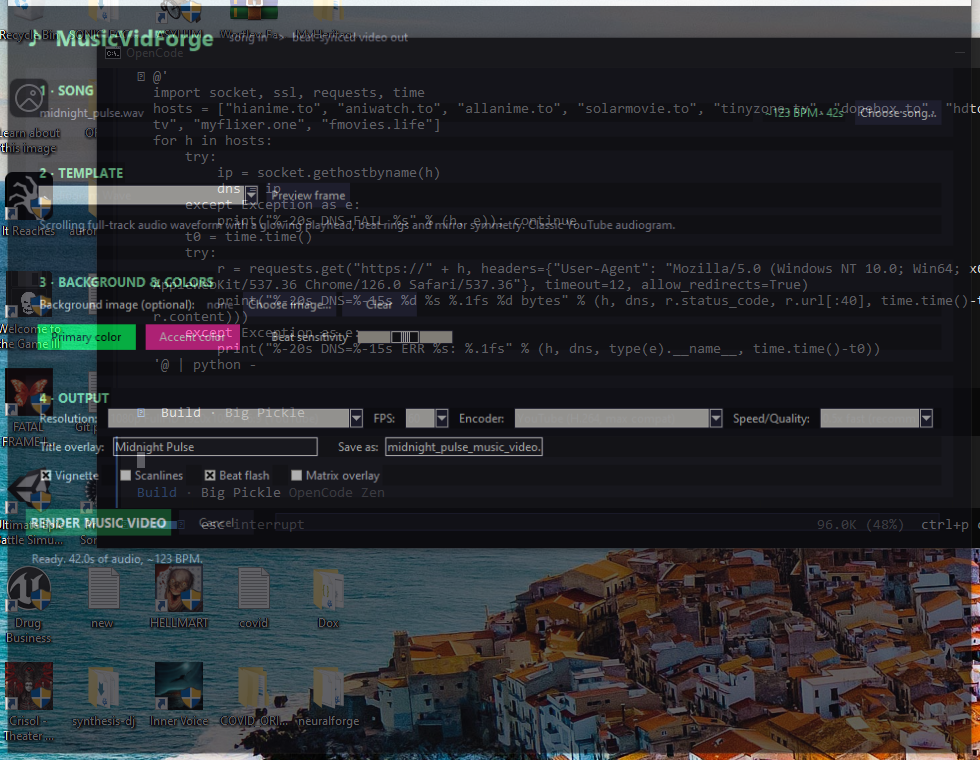
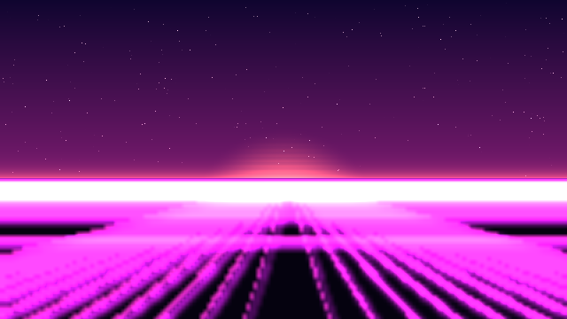
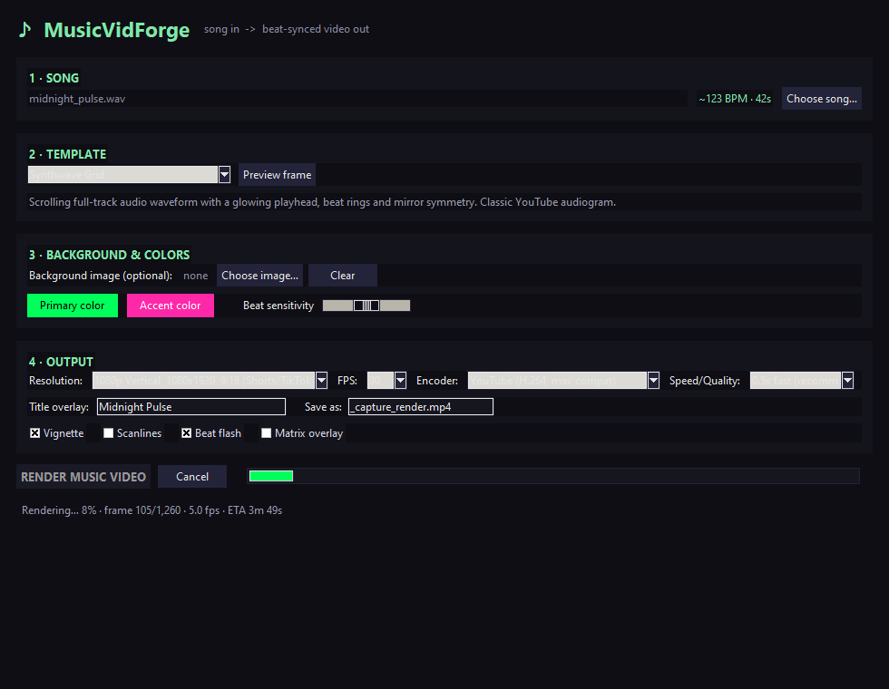

<p align="center">
  
</p>

# MUSICVIDFORGE :: BEAT-SYNCED MUSIC VIDEO ENGINE

**Turn any song into a beat-synced music video — right from your desktop.** Offline beat detection, 8 reactive visual templates, and 4K H.264/H.265 output.

<p align="center">
  
  
  
  
  <a href="LICENSE"></a>
</p>

<pre>
IDENT ......... MVF-03
CLASS ......... BEAT-SYNCED MUSIC VIDEO ENGINE
STATUS ........ SHIPPED / ONLINE
PIPELINE ...... AUDIO → BEAT DETECT → RENDER → MUX → MP4
TARGET ........ YOUTUBE · SHORTS · TIKTOK · INSTAGRAM
LINK .......... /playnexus-musicvidforge
</pre>

---

## // 01 :: SIGNAL

MusicVidForge is a desktop application that turns an audio file into a high-quality,
beat-synchronized music video. It detects beats **in-app with NumPy** (no internet
needed), then renders visuals that react to the music — flashes, particle bursts,
grid surges, RGB glitches and more — and muxes them with the original audio into a
finished MP4 for **YouTube, Shorts, TikTok and Instagram**.

```
Audio in  →  Beat detection  →  Template renders (8 styles)  →  Encoder  →  MP4 out
```

## ✨ Key features

- **Real beat detection, fully offline** — BPM + beat tracking with NumPy, no cloud calls.
- **8 visual templates** — every one reacts to detected beats:
  - **Matrix Rain** — classic green falling glyphs that accelerate on beats.
  - **Beat Pulse** — breathing colour field with expanding beat rings.
  - **Spectrum Bars** — 64-bar real-time frequency analyser.
  - **Audiogram Wave** — scrolling audio waveform with a playhead.
  - **Digital Glitch** — RGB-split chromatic glitches on every beat.
  - **Beat Fireworks** — particle bursts that detonate on the beat.
  - **Photo Zoom** — your own image with a slow Ken Burns pan/zoom + beat flashes.
  - **Synthwave Grid** — neon sunset, scanlined sun and a perspective grid surging on beats.
- **Production-quality output** — up to **4K**, H.264 (YouTube) / H.265 (max quality) /
  NVIDIA **NVENC** (fast GPU encoding), 30/60/24 FPS, 16:9 / 9:16 / 1:1.
- **Full customisation** — colours, beat sensitivity, custom background image, title overlay,
  overlay filters (vignette, scanlines, beat flash, matrix overlay).
- **Lossless audio pass-through** — original audio muxed back in as 320k AAC.
- **No network required** — everything runs locally.

## 🖼️ Screenshots



| Matrix Rain | Synthwave Grid |
|---|---|
|  |  |

*Rendering a 720p video in the app:*



## 🚀 Quick start

**Requirements:** Python 3.10+, `ffmpeg` on PATH ([gyan.dev](https://www.gyan.dev/ffmpeg/builds/) builds work well on Windows).

```bash
git clone https://github.com/Nortaq-PlayNexus/playnexus-musicvidforge.git
cd playnexus-musicvidforge
python -m venv .venv
.venv\Scripts\activate
pip install -r requirements.txt
python app.py
```

## 🎮 Usage

1. **Choose a song** — wait until BPM and length are detected.
2. **Pick a template** — one of the 8 beat-synced styles above.
3. **Optional extras** — custom background image, primary & accent colours,
   beat sensitivity, title overlay, output name.
4. **Set output** — resolution (4K / 1440p / 1080p / 9:16 / 1:1), FPS (60/30/24),
   encoder (H.264 / H.265 / NVENC).
5. **Tick overlay filters** — vignette, scanlines, beat flash, matrix overlay.
6. **Render** — watch the progress bar; the finished MP4 opens automatically.

See the [full documentation](docs/) for details, including [installation](docs/INSTALLATION.md),
[troubleshooting](docs/TROUBLESHOOTING.md) and the [architecture](docs/ARCHITECTURE.md).

## 📁 Project structure

```
MusicVidForge/
├── app.py                  # Tkinter GUI (entry point)
├── engine/
│   ├── audio.py            # beat/BPM detection (NumPy)
│   ├── templates.py        # 8 visual templates
│   └── render.py           # frame compositing + ffmpeg pipeline
├── tests/                  # automated test suite
├── assets/                 # screenshots & branding
├── docs/                   # documentation suite
└── requirements.txt        # runtime dependencies
```

## 📚 Documentation

| Document | Purpose |
|---|---|
| [Installation](docs/INSTALLATION.md) | Set up on Windows from scratch |
| [Usage & Development](docs/DEVELOPMENT.md) | Run, test and extend the app |
| [Architecture](docs/ARCHITECTURE.md) | How the rendering pipeline works |
| [Performance](docs/PERFORMANCE.md) | Tuning encode time vs. quality |
| [Troubleshooting](docs/TROUBLESHOOTING.md) | Common issues and fixes |
| [FAQ](docs/FAQ.md) | Frequently asked questions |
| [Roadmap](docs/ROADMAP.md) | Upcoming features |
| [Contributing](CONTRIBUTING.md) | How to help out |

## 🧪 Tests

```bash
pip install -r requirements.txt pytest
pytest
```

## 📜 License

[MIT](LICENSE) © 2026 Nortaq-PlayNexus
