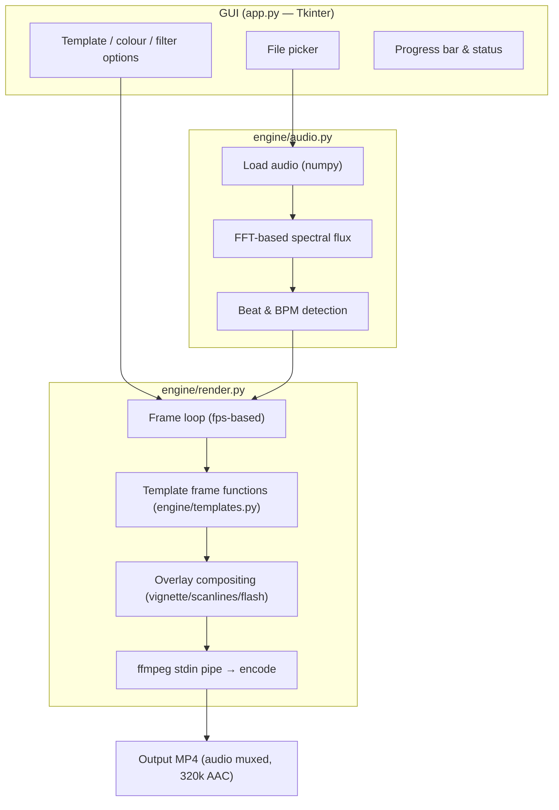

# Architecture

MusicVidForge is a small, layered desktop application: a **GUI layer** (`app.py`),
an **analysis layer** (`engine/audio.py`) and a **rendering layer**
(`engine/render.py` + `engine/templates.py`).

## Component responsibilities

### `app.py` — GUI layer

Tkinter window that collects inputs (song, template, colours, resolution, FPS,
encoder, overlays), triggers analysis, then drives rendering on worker threads so
the UI stays responsive. No rendering logic lives here.

### `engine/audio.py` — analysis layer

Reads the audio file into a NumPy array and computes:

- **BPM** and **beat times** via spectral flux — energy spikes in the frequency
  domain that indicate onsets, then a periodicity estimate from the onset
  envelope.

Beats are the single source of truth every template reacts to. Everything runs
locally; no network access.

### `engine/templates.py` — visual layer

Each template is a pure function `(frame_index, state) -> PIL.Image`. Examples:

- **Spectrum Bars** recomputes FFT bins per frame.
- **Matrix Rain / Beat Fireworks** evolve per-pixel particle fields.
- **Beat Pulse / Synthwave Grid / Digital Glitch** read the beat list and
  trigger an impulse when a beat lands on the current frame.

### `engine/render.py` — pipeline layer

- Builds the frame count from duration × fps.
- For each frame: calls the template, applies overlay filters, converts to RGB
  bytes and writes to `ffmpeg`'s stdin.
- ffmpeg encodes (H.264 / H.265 / NVENC), then muxes the original audio as
  320k AAC.

## Data flow

1. User selects an audio file.
2. `audio.py` analyzes it → `{bpm, beats, duration, sample_rate}`.
3. User picks template + output settings.
4. `render.py` opens an ffmpeg subprocess and streams frames.
5. Templates receive `(frame_no, state)` and emit `PIL.Image` frames.
6. Overlays are composed, frames are streamed, ffmpeg outputs the final MP4.
7. The app opens the finished file.

## Why these choices?

- **NumPy** — fast enough for real-time-ish beat detection with zero network
  dependencies and no heavyweight ML.
- **Pillow** — simple, portable pixel painting for 2D procedural visuals.
- **ffmpeg as subprocess** — battle-tested encoding (H.264/H.265/NVENC) without
  reinventing a codec.
- **Threading** — rendering runs off the UI thread so the progress bar stays live.
